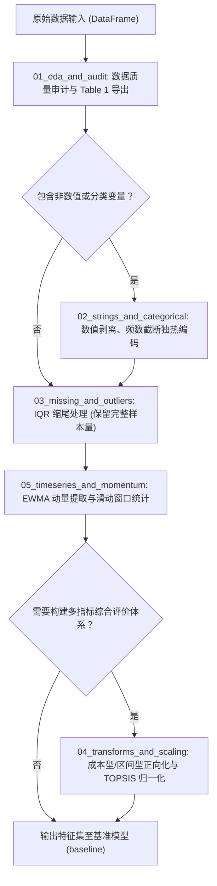
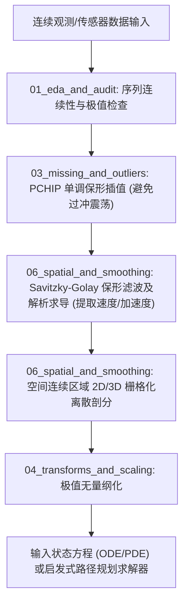

# 数据预处理工具箱 (Preprocessing Toolkit)

本模块提供针对数学建模竞赛中各类结构化与非结构化数据的原子化预处理函数库。模块采用防御性编程实现，具备参数边界校验、异常输入容错、学术级图表生成及 LaTeX 表格输出能力。

---

## 模块结构与功能索引

| 子模块目录 | 主要功能与数学方法 | 适用场景 | 对应文档与代码 |
| :--- | :--- | :--- | :--- |
| [**01_eda_and_audit**](file:///Users/ricardo/Codes/MCM-ICM-Preparation/coding/preprocessing/01_eda_and_audit/README.md) | 全字段数据质量审计、偏度/峰度高阶矩计算、常数列过滤、相关性矩阵计算与 LaTeX Table 1 导出 | 原始数据集分布摸底与描述性统计制表 | [代码](file:///Users/ricardo/Codes/MCM-ICM-Preparation/coding/preprocessing/01_eda_and_audit/eda_toolkit.py) \| [速查手册](file:///Users/ricardo/Codes/MCM-ICM-Preparation/coding/preprocessing/01_eda_and_audit/README.md) \| [理论指南](file:///Users/ricardo/Codes/MCM-ICM-Preparation/coding/preprocessing/01_eda_and_audit/GUIDE.md) |
| [**02_strings_and_categorical**](file:///Users/ricardo/Codes/MCM-ICM-Preparation/coding/preprocessing/02_strings_and_categorical/README.md) | 正则提取纯数值、二元变量映射、有序分类序数编码、带低频阈值归并的独热编码（One-Hot）、5 折交叉验证目标编码（Target Encoding） | 文本字段清洗、类别型特征数值化 | [代码](file:///Users/ricardo/Codes/MCM-ICM-Preparation/coding/preprocessing/02_strings_and_categorical/category_toolkit.py) \| [速查手册](file:///Users/ricardo/Codes/MCM-ICM-Preparation/coding/preprocessing/02_strings_and_categorical/README.md) \| [理论指南](file:///Users/ricardo/Codes/MCM-ICM-Preparation/coding/preprocessing/02_strings_and_categorical/GUIDE.md) |
| [**03_missing_and_outliers**](file:///Users/ricardo/Codes/MCM-ICM-Preparation/coding/preprocessing/03_missing_and_outliers/README.md) | Tukey IQR 与 Z-score 异常掩码检测、双端缩尾截断（Winsorization）、分段三次埃尔米特保形插值（PCHIP）、多维 KNN 距离加权插补 | 离群点治理（保持样本容量）、物理轨迹/时序缺失修补 | [代码](file:///Users/ricardo/Codes/MCM-ICM-Preparation/coding/preprocessing/03_missing_and_outliers/cleaning_toolkit.py) \| [速查手册](file:///Users/ricardo/Codes/MCM-ICM-Preparation/coding/preprocessing/03_missing_and_outliers/README.md) \| [理论指南](file:///Users/ricardo/Codes/MCM-ICM-Preparation/coding/preprocessing/03_missing_and_outliers/GUIDE.md) |
| [**04_transforms_and_scaling**](file:///Users/ricardo/Codes/MCM-ICM-Preparation/coding/preprocessing/04_transforms_and_scaling/README.md) | Box-Cox 与 Yeo-Johnson 幂变换（MLE 求解最佳 $\lambda$）、效益型/成本型极值归一化、区间最优型分段惩罚映射、TOPSIS 向量规范化 | 偏态数据正态化修正、多准则综合评价指标预处理 | [代码](file:///Users/ricardo/Codes/MCM-ICM-Preparation/coding/preprocessing/04_transforms_and_scaling/transform_toolkit.py) \| [速查手册](file:///Users/ricardo/Codes/MCM-ICM-Preparation/coding/preprocessing/04_transforms_and_scaling/README.md) \| [理论指南](file:///Users/ricardo/Codes/MCM-ICM-Preparation/coding/preprocessing/04_transforms_and_scaling/GUIDE.md) |
| [**05_timeseries_and_momentum**](file:///Users/ricardo/Codes/MCM-ICM-Preparation/coding/preprocessing/05_timeseries_and_momentum/README.md) | 严格因果滑动窗口特征衍生、指数加权移动平均（EWMA）记忆衰减动量模型、连续运行长度（Streak）统计、多阶差分与滞后项 | 微观事件流（如逐球/逐笔记录）动态演化建模 | [代码](file:///Users/ricardo/Codes/MCM-ICM-Preparation/coding/preprocessing/05_timeseries_and_momentum/timeseries_toolkit.py) \| [速查手册](file:///Users/ricardo/Codes/MCM-ICM-Preparation/coding/preprocessing/05_timeseries_and_momentum/README.md) \| [理论指南](file:///Users/ricardo/Codes/MCM-ICM-Preparation/coding/preprocessing/05_timeseries_and_momentum/GUIDE.md) |
| [**06_spatial_and_smoothing**](file:///Users/ricardo/Codes/MCM-ICM-Preparation/coding/preprocessing/06_spatial_and_smoothing/README.md) | Savitzky-Golay 局部多项式保形滤波与解析数值求导、2D/3D 空间连续区域网格化剖分与拓扑邻接图构建、球面大圆距离（Haversine）矩阵 | 传感器高频噪声压制、空间搜寻与路径规划离散化 | [代码](file:///Users/ricardo/Codes/MCM-ICM-Preparation/coding/preprocessing/06_spatial_and_smoothing/spatial_smooth_toolkit.py) \| [速查手册](file:///Users/ricardo/Codes/MCM-ICM-Preparation/coding/preprocessing/06_spatial_and_smoothing/README.md) \| [理论指南](file:///Users/ricardo/Codes/MCM-ICM-Preparation/coding/preprocessing/06_spatial_and_smoothing/GUIDE.md) |

---

## 典型题型处理流程

### 数据驱动题型（时序 / 事件流 / 截面数据）


### 物理仿真与空间连续题型（轨迹 / 传感器 / 空间搜寻）


---

## 快速调用示例 (API Quickstart)

```python
# 1. 导出 LaTeX Table 1 描述性统计表格
from eda_toolkit import export_latex_table1
latex_table = export_latex_table1(df, caption="Descriptive Statistics of Variables")

# 2. 字符串清洗与带频数保护的独热编码
from category_toolkit import clean_numeric_string, encode_onehot
df["Price"] = clean_numeric_string(df["Price"])
df = encode_onehot(df, column="Category", min_freq=0.03, drop_first=True)

# 3. 异常值缩尾治理（保持样本容量）
from cleaning_toolkit import winsorize_iqr
df["Feature_A"] = winsorize_iqr(df["Feature_A"], k=1.5)

# 4. 物理保形插值（保持局部单调性，无过冲震荡）
from cleaning_toolkit import interpolate_series
df["Trajectory"] = interpolate_series(df["Trajectory"], method="pchip")

# 5. Box-Cox 幂变换正态化
from transform_toolkit import transform_boxcox
df["Transformed_Y"], opt_lmbda, shift_c = transform_boxcox(df["Raw_Y"])

# 6. 成本型指标正向化映射
from transform_toolkit import scale_cost
df["Cost_Benefit"] = scale_cost(df["Emission"], method="difference")

# 7. EWMA 动态动量衰减模型
from timeseries_toolkit import calc_ewma_momentum
df["Momentum"] = calc_ewma_momentum(df["Score_Diff"], alpha=0.3)

# 8. 传感器信号滤波与一阶解析求导（提取速度）
from spatial_smooth_toolkit import smooth_savitzky_golay
velocity = smooth_savitzky_golay(df["Position"], window_length=15, polyorder=2, deriv=1, delta=0.1)

# 9. 2D 连续空间离散化网格剖分
from spatial_smooth_toolkit import create_spatial_grid_2d
grid_df, adjacency_dict = create_spatial_grid_2d(x_bounds=(0, 10), y_bounds=(0, 10), step=1.0)
```
